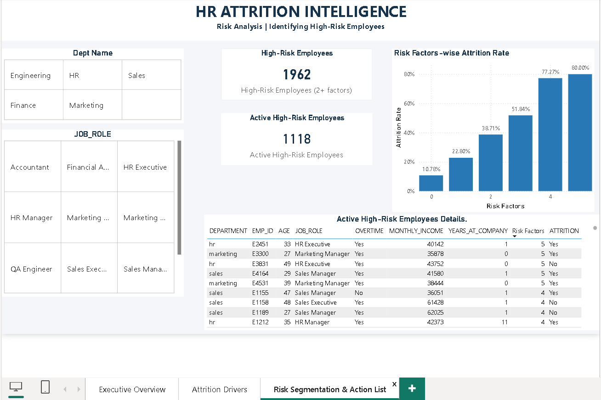

# 📊 HR Attrition Intelligence

In this project I looked at what is linked to employees leaving a company. I kept the raw HR files in AWS S3, cleaned them with SQL in Snowflake, studied the patterns, trained a model to guess who might leave, and showed the results in a live Streamlit app and a 3-page Power BI dashboard.

🔗 **Live app:** https://hr-attrition-intelligence-adzrfc9t4ztbjwglgojzvc.streamlit.app/

---

## 🎯 What this project is about

This project is based on a class case study. The company, TechNova, is made up. It has about 5,000 employees in 5 departments (Sales, Engineering, HR, Marketing and Finance). In the case study, attrition went from 18% to 27% in two quarters. HR only found out why people left after they had already left.

I wanted to find out what is linked to people leaving, and to see if a model can guess who may leave next.

---

## 🛠️ Tools I used

| Area | Tools |
|---|---|
| Cloud storage | AWS S3 |
| Data warehouse | Snowflake, SQL |
| Data analysis | Python, pandas, numpy |
| Machine learning | scikit-learn (Random Forest), imbalanced-learn (SMOTE) |
| Charts | matplotlib, seaborn, Plotly |
| App | Streamlit |
| Dashboard | Power BI, DAX |
| Version control | Git, GitHub |

---

## 🏗️ How the project works

```
Source CSV files (employee info, performance, salary)
        |
        v
AWS S3 (raw/ folder)
        |
        v
Snowflake: raw tables -> clean tables -> hr_attrition_final
        |
        v
Python: charts + Random Forest model
        |
        +--> Streamlit app
        +--> Power BI dashboard
```

- **AWS S3:** I uploaded the source files to a bucket, in a `raw/` folder.
- **Snowflake:** I made an external stage that points to the S3 folder. Then I loaded the 3 main files (employee info, performance and salary) into 3 raw tables with `COPY INTO`.
- **SQL cleaning:** I trimmed spaces, changed the data types, removed duplicates and filled missing job satisfaction with 3. Then I joined the 3 tables into one table called `hr_attrition_final`. All the SQL is in `sql/pipeline.sql`.
- **Python:** `src/eda.py` makes the charts and `src/train_model.py` trains the model.
- **Streamlit and Power BI:** these show the results.

> **Note:** My Snowflake free trial ended, so the app now reads a CSV copy of the final table (`data/hr_attrition_final.csv`). The file `rebuild_data.py` makes the same table from the source files, using the same cleaning steps as the SQL.

---

## 📌 Main numbers

| What | Value |
|---|---|
| Total employees | 4,700 |
| Employees who left | 1,359 |
| Attrition rate | 28.9% |
| Average monthly income | ₹61,279 |
| Current employees with 2 or more risk factors | 1,118 |

The data is made up (synthetic). It is not from a real company.

Columns: EMP_ID, AGE, DEPARTMENT, JOB_ROLE, GENDER, MARITAL_STATUS, PERFORMANCE_RATING, OVERTIME, DISTANCE_FROM_HOME, ATTRITION, MONTHLY_INCOME, YEARS_AT_COMPANY, JOB_SATISFACTION.

---

## 📈 Power BI Dashboard

I made a 3-page dashboard in Power BI. The file is `powerbi/HR_Attrition_Dashboard.pbix`. You need Power BI Desktop on Windows to open it.

### Page 1: Executive Overview
Total employees, employees who left, attrition rate, average income and high-risk employees. It also shows attrition by department, job role and tenure, and a decomposition tree.


### Page 2: Attrition Drivers
Attrition rate by distance, income, age, performance rating, job satisfaction and overtime. There is also a Key Influencers chart.


### Page 3: Risk Analysis
For every employee I counted 5 risk factors: overtime, low income, long distance, short tenure and low job satisfaction. Employees with 2 or more risk factors are called high-risk. The page also has a table that lists the current employees with 2 or more risk factors, with the highest risk at the top.



### What you can do in the dashboard
- Use slicers for department, job role, overtime, age group, gender and marital status
- Click on a chart and the other charts change with it
- Open the decomposition tree and key influencers charts

### DAX in the dashboard
- **Measures:** Total Employees, Employees Left, Attrition Rate, Avg Monthly Income, Avg Tenure, Avg Job Satisfaction, Overtime %, High-Risk Employees
- **Calculated columns:** Age Group, Income Band, Tenure Band, Distance Band and Risk Factors (counts how many of the 5 risk factors an employee has)

> The data is saved inside the .pbix file. Please do not click Refresh, because the file was connected to Snowflake and my trial has ended.

---

## 🖥️ Streamlit App

🔗 https://hr-attrition-intelligence-adzrfc9t4ztbjwglgojzvc.streamlit.app/

- **Dashboard tab:** filter by department and tenure and see the main numbers and charts. If you click a bar in the department chart, the charts below it change too.
- **Predict Attrition tab:** type in an employee's details and the model shows a risk result.


---

## 🔍 What the data showed

- Overall attrition is **28.9%**.
- **Overtime:** 41.6% of people who do overtime left. For people who do not, it is 23.3%.
- **Low pay:** 42.9% left when monthly income was below 45K.
- **New joiners** (0 to 1 years) left the most, at 40.2%.
- **Long distance:** people living 21 km or more away left more (36.3%).
- **Job satisfaction:** ratings 1 and 2 had about 35 to 37% attrition. Ratings 3 and 4 had about 22%.
- **Age** did not make much difference. It was about 28 to 30% in every age group.
- **More risk factors, more attrition.** It goes from 10.8% with no risk factors to about 77% with four.
- **Departments:** HR has the highest attrition (33.4%) and Finance has the lowest (24.7%).

This shows what is linked to attrition. It does not prove what causes it.

---

## 🤖 The Model

I used a Random Forest. Only about 29% of employees left, so there are many more "stayed" rows than "left" rows. To fix this I used SMOTE, which adds extra practice rows for the "left" group. I used SMOTE only on the training part and never on the test data, so the results stay fair. I tuned the model with GridSearchCV and kept 20% of the data aside for testing.

| Test result (people who left) | Value |
|---|---|
| Accuracy | 0.64 |
| Precision | 0.39 |
| Recall | 0.46 |
| F1 score | 0.42 |

**What this means:** the model is not very strong. It catches about 46% of the people who really left. Out of the people it marks as "will leave", about 39% really do leave. I think this happens because the data is made up and does not have a very clear pattern. Accuracy is only 64%. If a model said "stayed" for everyone it would get about 71%, so accuracy is not a good way to judge this model. That is why I looked at precision and recall.

Good to know:

- Feature importance shows what the model used the most. It does not prove what causes people to leave.
- The model uses age, gender and marital status. In a real HR system these should be checked or removed, because they can make the results unfair.

---

## 📁 Folder structure

```
HR-Attrition-Intelligence/
├── .devcontainer/
│   └── devcontainer.json
├── data/
│   ├── employee_info.csv
│   ├── performance_attendance.csv
│   ├── salary_details.csv
│   └── hr_attrition_final.csv
├── models/
│   └── attrition_model.pkl
├── outputs/
│   ├── attrition_by_department.png
│   ├── attrition_by_overtime.png
│   ├── salary_vs_attrition.png
│   ├── powerbi_executive_overview.png
│   ├── powerbi_attrition_drivers.png
│   ├── powerbi_risk_analysis.png
│   ├── streamlit_dashboard.png
│   └── streamlit_predict.png
├── powerbi/
│   └── HR_Attrition_Dashboard.pbix
├── sql/
│   └── pipeline.sql
├── src/
│   ├── connect_snowflake.py
│   ├── eda.py
│   └── train_model.py
├── .gitignore
├── app.py
├── export_snapshot.py
├── main.py
├── rebuild_data.py
├── requirements.txt
└── README.md
```

---

## ▶️ How to run it

```
git clone https://github.com/ABHAYMARWADE2004/HR-Attrition-Intelligence.git
cd HR-Attrition-Intelligence

python -m venv venv
venv\Scripts\activate          # on Mac or Linux: source venv/bin/activate
pip install -r requirements.txt

python main.py
python -m streamlit run app.py
```

---

## 🚀 What I want to do next

- Make the model catch more of the people who leave (a higher recall)
- Take age, gender and marital status out of the model

---

## 👨‍💻 Author

**Abhay Marwade**
Aspiring Data Analyst | Data Science & AI Enthusiast

- GitHub: https://github.com/ABHAYMARWADE2004
- LinkedIn: https://www.linkedin.com/in/abhay-marwade-681108295

⭐ If you found this project interesting, feel free to give it a star.
