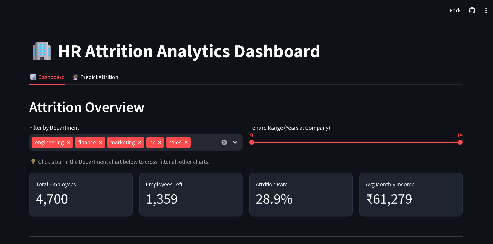
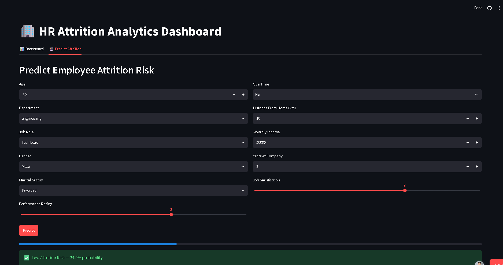
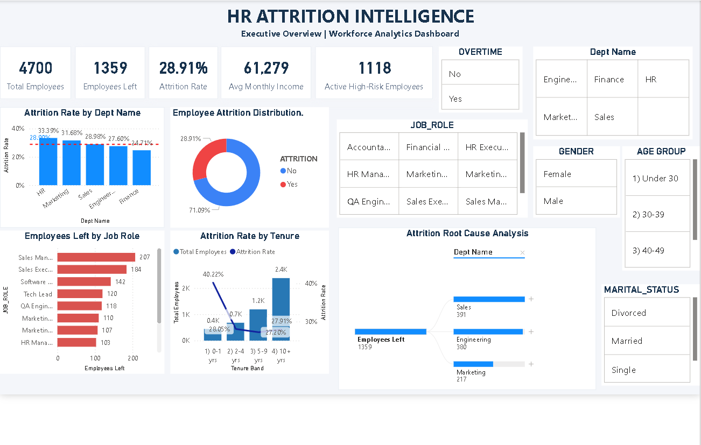
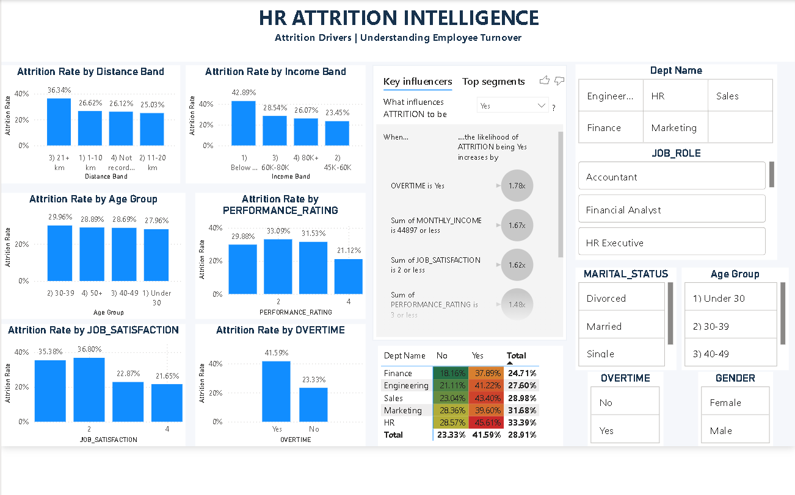
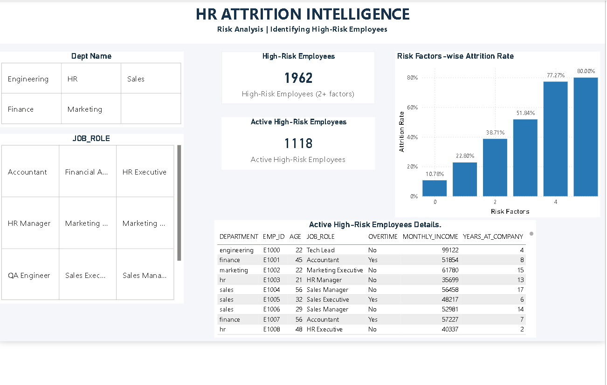

# HR Attrition Intelligence

This is my project on employee attrition. I took HR data, cleaned it with SQL in Snowflake, looked at why people leave, trained a model to predict who might leave, and made a Streamlit app and a Power BI dashboard to show the results.

**Live app:** https://hr-attrition-intelligence-adzrfc9t4ztbjwglgojzvc.streamlit.app/

## The problem

This project is based on a class case study. The company, TechNova, is made up. It has about 5,000 employees in 5 departments (Sales, Engineering, HR, Marketing, Finance). In the case study, attrition went up from 18% to 27% in two quarters. HR only found out why people left after they had already left, in exit interviews.

So I tried to answer these questions:

1. How many people leave, and which departments, roles and tenure groups are the worst?
2. What is linked to people leaving (salary, overtime, distance, job satisfaction)?
3. Can we predict who is likely to leave?

## Tech stack

| Area | Tools |
|---|---|
| Cloud storage | AWS S3 |
| Data warehouse | Snowflake, SQL |
| Data analysis | Python, pandas, numpy |
| Machine learning | scikit-learn (Random Forest), imbalanced-learn (SMOTE) |
| Charts | matplotlib, seaborn, Plotly |
| App | Streamlit |
| Dashboard | Power BI |
| Version control | Git, GitHub |

## How the data flows

```
Source CSV files (employee info, performance, salary)
        |
        v
AWS S3 (raw/ folder)
        |
        v
Snowflake: raw tables -> clean tables -> hr_attrition_final
        |
        v
Python: EDA charts + Random Forest model
        |
        +--> Streamlit app
        +--> Power BI dashboard
```

- **AWS S3:** I uploaded the source CSV files to a bucket, in a `raw/` folder.
- **Snowflake:** I made an external stage that points to the S3 folder and loaded the 3 main files (employee info, performance, salary) into 3 raw tables with `COPY INTO`. Then I cleaned them with SQL (trim spaces, change types, remove duplicates, fill missing job satisfaction with 3) and joined them into one table called `hr_attrition_final`. All the SQL is in `sql/pipeline.sql`.
- **Python:** I made charts (`src/eda.py`) and trained the model (`src/train_model.py`).
- **Streamlit and Power BI:** these show the results.

**Note:** My Snowflake free trial ended, so the app now reads a CSV copy of the final table (`data/hr_attrition_final.csv`). The file `rebuild_data.py` makes the same table from the source CSVs using the same cleaning steps as the SQL.

## The data

The data is synthetic (not real). It has 4,700 employees. 1,359 of them left, which is about 29%.

Columns: EMP_ID, AGE, DEPARTMENT, JOB_ROLE, GENDER, MARITAL_STATUS, PERFORMANCE_RATING, OVERTIME, DISTANCE_FROM_HOME, ATTRITION, MONTHLY_INCOME, YEARS_AT_COMPANY, JOB_SATISFACTION.

## Streamlit app

Live app: https://hr-attrition-intelligence-adzrfc9t4ztbjwglgojzvc.streamlit.app/

It has two tabs:

- **Dashboard:** filter by department and tenure, see the main numbers and charts. Clicking a bar in the department chart filters the other charts.
- **Predict Attrition:** fill in an employee's details and the model gives a risk result.




## Power BI dashboard

I made a 3 page dashboard in Power BI. The file is `powerbi/HR_Attrition_Dashboard.pbix` (you need Power BI Desktop on Windows to open it).

1. **Executive Overview:** total employees, how many left, attrition rate, and attrition by department, job role and tenure.
2. **Attrition Drivers:** attrition rate by distance, income, age, performance, job satisfaction and overtime.
3. **Risk Analysis:** I made a simple risk score by counting risk factors (overtime, low income, long distance, new joiner, low satisfaction). It also lists current employees with 2 or more risk factors.





The data is saved inside the .pbix file. Please don't click Refresh, because it was connected to Snowflake and my trial has ended.

## What I found

- Overall attrition is 28.9%.
- Overtime matters a lot. 41.6% of people who do overtime left, compared to 23.3% of people who don't.
- Low salary matters. 42.9% left when monthly income was below 45K.
- New joiners (0 to 1 years) left the most, at 40.2%.
- People living 21 km or more away left more (36.3%).
- Low job satisfaction (rating 1 or 2) had about 35 to 37% attrition. Rating 3 or 4 had about 22%.
- Age did not make much difference.
- More risk factors means more attrition. It goes from 10.8% with no risk factors to about 77% with four.
- HR has the highest attrition (33.4%) and Finance the lowest (24.7%).

## What HR can do

Based on what I found, these are the things I would suggest HR looks at first:

1. **Check overtime.** People doing overtime left a lot more (41.6% against 23.3%). HR can look at the teams with the most overtime and see if the workload is too high.
2. **Look at low salaries.** Attrition was 42.9% for people earning below 45K a month. HR can review pay for this group first.
3. **Help new joiners.** People in their first year left the most (40.2%). Better onboarding and regular check-ins in the first year could help.
4. **Talk to people with low job satisfaction.** Employees who rated satisfaction 1 or 2 left much more. Short surveys and talks with managers can catch problems early.
5. **Think about long distances.** People living 21 km or more away left more (36.3%). Work from home days or transport help could be an option.
6. **Start with the right departments.** Sales and Engineering lose the most people in numbers (391 and 380). HR and Marketing have the highest rates (33.4% and 31.7%).
7. **Use the risk list.** In the Power BI dashboard, 1,118 current employees have 2 or more risk factors. Managers can talk to them first.

These suggestions come from patterns in my synthetic data. They show what is linked to attrition, not proof of what causes it.

## The model

I used a Random Forest. Only about 29% of employees left, so the classes are uneven. I used SMOTE on the training data to balance it, and tuned the model with GridSearchCV. I kept 20% of the data aside for testing.

| Result on test data (for people who left) | Value |
|---|---|
| Accuracy | 0.68 |
| Precision | 0.42 |
| Recall | 0.31 |
| F1 score | 0.35 |

The model is not very strong. It only catches about 31% of the people who actually left. I think this is because the data is synthetic and does not have a very clear pattern. I did not rely on accuracy, because a model that says "No" for everyone would also get around 71%.

Other things to know:

- Feature importance only shows what the model used the most. It does not prove what causes people to leave.
- The model uses age, gender and marital status. In a real HR system these should be checked or removed, because they can lead to unfair results.

## Project folder

```
HR-Attrition-Intelligence/
├── .devcontainer/
│   └── devcontainer.json
├── data/
│   ├── employee_info.csv
│   ├── performance_attendance.csv
│   ├── salary_details.csv
│   └── hr_attrition_final.csv
├── models/
│   └── attrition_model.pkl
├── outputs/
│   ├── attrition_by_department.png
│   ├── attrition_by_overtime.png
│   ├── salary_vs_attrition.png
│   ├── powerbi_executive_overview.png
│   ├── powerbi_attrition_drivers.png
│   ├── powerbi_risk_analysis.png
│   ├── streamlit_dashboard.png
│   └── streamlit_predict.png
├── powerbi/
│   └── HR_Attrition_Dashboard.pbix
├── sql/
│   └── pipeline.sql
├── src/
│   ├── connect_snowflake.py
│   ├── eda.py
│   └── train_model.py
├── .gitignore
├── app.py
├── export_snapshot.py
├── main.py
├── rebuild_data.py
├── requirements.txt
└── README.md
```

## How to run it

```
git clone https://github.com/ABHAYMARWADE2004/HR-Attrition-Intelligence.git
cd HR-Attrition-Intelligence

python -m venv venv
venv\Scripts\activate
pip install -r requirements.txt

python main.py
python -m streamlit run app.py
```

---

## 👨‍💻 Author

**Abhay Marwade**
Aspiring Data Analyst | Data Science & AI Enthusiast

- GitHub: https://github.com/ABHAYMARWADE2004
- LinkedIn: https://www.linkedin.com/in/abhay-marwade-681108295

⭐ If you found this project interesting, feel free to give it a star.
