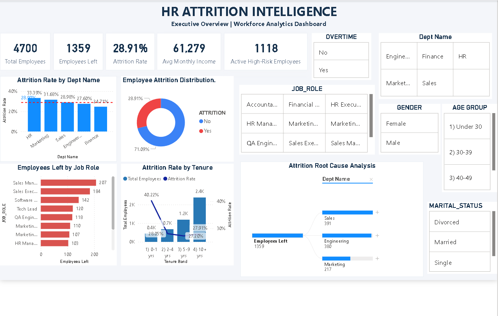
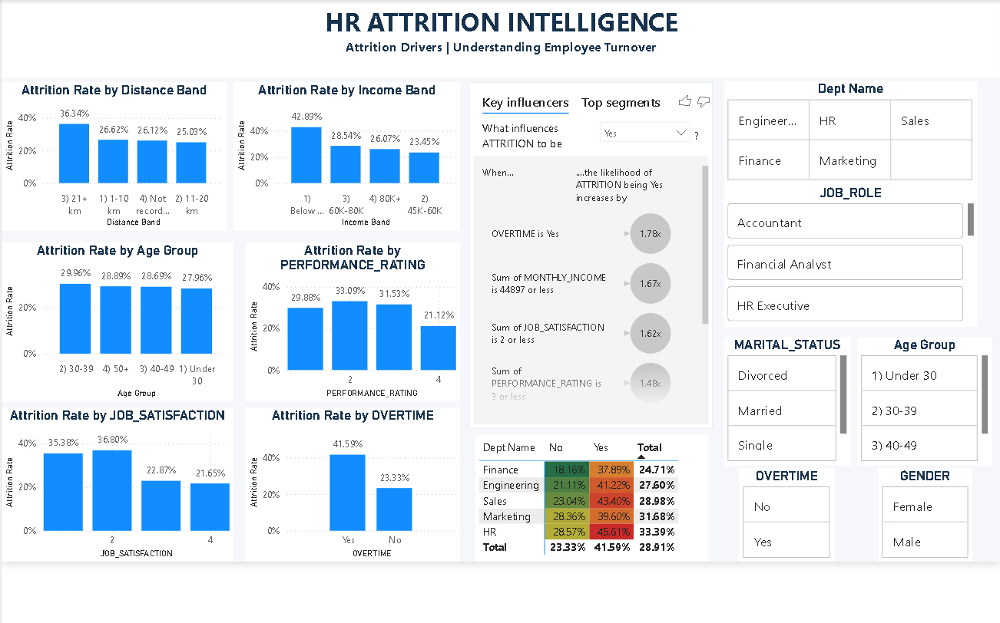
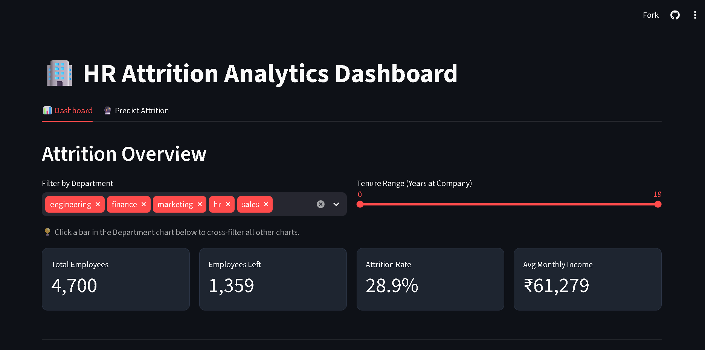
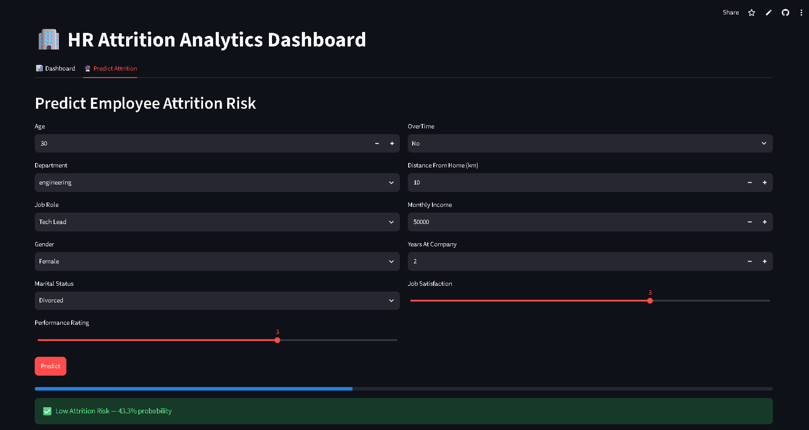

# 📊 HR Attrition Intelligence

In this project, I worked on understanding why employees leave a company and how HR teams can identify possible attrition risks.

I started with raw HR data, stored the files in AWS S3, cleaned and combined the data using SQL in Snowflake, and explored the results using Python. I also trained a Machine Learning model to predict employee attrition and built a live Streamlit application along with a 3-page Power BI dashboard.

🔗 **Live Streamlit App:**

https://hr-attrition-intelligence-adzrfc9t4ztbjwglgojzvc.streamlit.app/

---

## 🎯 Project Objective

This project is based on a classroom case study. The company used in the case study is called **TechNova**. It is a fictional company with around 5,000 employees across five departments: Sales, Engineering, HR, Marketing and Finance.

In the case study, the company's attrition rate increased from 18% to 27% over two quarters. The HR team wanted a better way to understand employee attrition instead of looking only at employees who had already left.

My goal was to:

- Understand employee attrition patterns.
- Identify factors associated with employees leaving.
- Build a Machine Learning model to predict possible employee attrition.
- Create an interactive dashboard for HR analysis.
- Make the results available through a Streamlit application.

---

## 🛠️ Tools & Technologies

| Area | Tools |
|---|---|
| Cloud Storage | AWS S3 |
| Data Warehouse | Snowflake |
| Data Cleaning | SQL |
| Data Analysis | Python, Pandas, NumPy |
| Machine Learning | Scikit-learn, Random Forest, SMOTE |
| Data Visualization | Matplotlib, Seaborn, Plotly |
| Web Application | Streamlit |
| Dashboard | Power BI, DAX |
| Version Control | Git, GitHub |

---

## 🏗️ Project Flow

The project follows this workflow:

```text
HR Source Files
      |
      v
AWS S3 (Raw Data)
      |
      v
Snowflake
      |
      v
SQL Data Cleaning & Transformation
      |
      v
HR_ATTRITION_FINAL
      |
      v
Python Data Analysis & Machine Learning
      |
      +--------------------+
      |                    |
      v                    v
Streamlit App        Power BI Dashboard
```

### How I worked on the project

- **AWS S3:** I uploaded the original HR source files into an S3 bucket under the `raw/` folder.

- **Snowflake:** I created an external stage connected to the S3 folder and loaded the three main source files into Snowflake raw tables using `COPY INTO`.

- **SQL:** I cleaned the data by trimming extra spaces, correcting data types, removing duplicates and handling missing job satisfaction values. I then joined the tables to create the final table named `hr_attrition_final`.

- **Python:** I used `src/eda.py` for data analysis and charts. I used `src/train_model.py` to train and evaluate the Random Forest model.

- **Streamlit:** I created a web application where users can explore attrition patterns and check employee attrition predictions.

- **Power BI:** I created a 3-page interactive dashboard to study overall attrition, factors associated with attrition and employee risk levels.

The SQL queries used in the project are available in `sql/pipeline.sql`.

> **Note about Snowflake:** My Snowflake free trial has ended. During development, I used Snowflake for data loading, SQL cleaning and transformation. I saved a CSV copy of the final dataset at `data/hr_attrition_final.csv`. The Streamlit application now reads this saved dataset instead of connecting to Snowflake. The `rebuild_data.py` script can recreate the final dataset from the source files using the project's cleaning steps.

---

## 📌 Key KPIs

The final dataset contains 4,700 employee records.

| Metric | Value |
|---|---:|
| Total Employees | 4,700 |
| Employees Who Left | 1,359 |
| Attrition Rate | 28.9% |
| Average Monthly Income | ₹61,279 |
| Current Employees with 2 or More Risk Factors | 1,118 |

**Dataset Columns:**

`EMP_ID`, `AGE`, `DEPARTMENT`, `JOB_ROLE`, `GENDER`, `MARITAL_STATUS`, `PERFORMANCE_RATING`, `OVERTIME`, `DISTANCE_FROM_HOME`, `ATTRITION`, `MONTHLY_INCOME`, `YEARS_AT_COMPANY`, `JOB_SATISFACTION`

The dataset is synthetic and was used for learning and project development. It does not contain real employee records from an actual company.

---

## 📈 Power BI Dashboard

I created a 3-page Power BI dashboard to make the attrition data easier to understand.

The Power BI file is available here:

`powerbi/HR_Attrition_Dashboard.pbix`

You need Power BI Desktop on Windows to open the file.

### 1. Executive Overview

This page gives an overall view of the company, including total employees, employees who left, attrition rate, average monthly income and high-risk employees.

It also includes attrition analysis by department, job role and tenure, along with a decomposition tree.



### 2. Attrition Drivers

This page helps explore how attrition rates differ across factors such as:

- Distance from home
- Monthly income
- Age
- Performance rating
- Job satisfaction
- Overtime

It also includes a Key Influencers visual to explore factors associated with attrition.



### 3. Risk Analysis

On this page, I used five risk factors to identify employees who may need attention:

- Overtime
- Low monthly income
- Long distance from home
- Short tenure
- Low job satisfaction

Employees with two or more of these factors are classified as high-risk for this project.

The page includes risk-related visuals and a table showing current employees with two or more risk factors, with higher risk counts shown first.


### Dashboard Features

- Slicers for department, job role, overtime, age group, gender and marital status.
- Interactive charts that respond to selections.
- Decomposition tree for exploring attrition data.
- Key Influencers visual for exploring patterns.
- Employee risk analysis table.

### 🧮 DAX Used

I created DAX measures for:

- Total Employees
- Employees Left
- Attrition Rate
- Average Monthly Income
- Average Tenure
- Average Job Satisfaction
- Overtime Percentage
- High-Risk Employees

I also created calculated columns for:

- Age Group
- Income Band
- Tenure Band
- Distance Band
- Risk Factors

The Risk Factors column counts how many of the five defined risk factors apply to an employee.

> **Important:** The Power BI file contains the imported dataset. Since my Snowflake trial has ended, please do not click Refresh in Power BI. The existing report can be opened and explored using the saved data.

---

## 🖥️ Streamlit App

I also deployed the project as a live Streamlit application.

🔗 **Live App:**

https://hr-attrition-intelligence-adzrfc9t4ztbjwglgojzvc.streamlit.app/

The application has two main sections:

### 1. Dashboard

- View important employee and attrition numbers.
- Filter data by department and tenure.
- Explore different attrition charts.
- Interact with charts to explore the data.



### 2. Predict Attrition

- Enter employee details.
- Submit the information to the trained Random Forest model.
- View the model's attrition prediction.



The application currently uses the saved CSV dataset and original trained model available in the project.

---

## 🔍 Key Insights

During my analysis, I found the following patterns in the dataset:

- **Overall Attrition:** Around 28.9% of employees left the company.
- **Overtime:** Attrition was 41.6% among employees who worked overtime, compared with 23.3% among those who did not.
- **Monthly Income:** Employees earning below ₹45,000 had an attrition rate of 42.9%.
- **New Employees:** Employees with 0 to 1 year of experience at the company had the highest attrition rate, at 40.2%.
- **Distance from Home:** Employees living 21 km or more away had an attrition rate of 36.3%.
- **Job Satisfaction:** Employees with satisfaction ratings of 1 and 2 had attrition rates of around 35% to 37%. Ratings of 3 and 4 had rates of around 22%.
- **Age:** Attrition rates were fairly similar across age groups, ranging from around 28% to 30%.
- **Risk Factors:** Attrition increased as the number of risk factors increased. It ranged from 10.8% for employees with no risk factors to around 77% for employees with four risk factors.
- **Departments:** HR had the highest attrition rate at 33.4%, while Finance had the lowest at 24.7%.

These results show patterns and relationships in the dataset. They do not prove that any particular factor directly causes an employee to leave.

---

## 🤖 Machine Learning Model

For attrition prediction, I used a **Random Forest Classifier**.

The dataset was imbalanced because more employees stayed than left. To handle this, I used SMOTE to create additional training samples for the minority class.

I also used GridSearchCV to test different model settings and select the best parameters.

### Model Workflow

1. Loaded the final HR dataset.
2. Removed the employee ID column.
3. Encoded categorical features.
4. Handled missing numerical values.
5. Split the dataset into training and testing sets (80:20).
6. Applied SMOTE within the training and cross-validation pipeline.
7. Tuned the Random Forest model using GridSearchCV.
8. Evaluated the model on the test data.

### Model Performance

The following results are from my original trained model.

| Metric | Result |
|---|---:|
| Accuracy | 63.62% |
| Precision (Attrition) | 39% |
| Recall (Attrition) | 46% |
| F1-Score (Attrition) | 42% |

### What These Results Mean

The model correctly identified around 46% of the employees who actually left.

Its precision was around 39%, which means that among the employees predicted as likely to leave, around 39% actually left in the test dataset.

The model is not highly accurate yet, and there is room for improvement.

Accuracy alone is not enough to judge this model. Since most employees in the dataset stayed, predicting that everyone would stay would already give an accuracy of around 71%.

That is why I also considered precision, recall and F1-score while evaluating the model.

**A few important points:**

- SMOTE was applied during model training, not to the test samples.
- The original preprocessing steps included categorical encoding and missing-value handling before the train-test split. Moving all preprocessing inside the training pipeline is an improvement I would make in a future version.
- Feature importance shows which features the model used most. It does not prove that those features cause attrition.
- The model uses age, gender and marital status. In a real HR application, these features would need careful fairness and bias checks before being used for any decision.
- The model's predictions should be treated as estimates, not as final decisions about employees.

---

## 📁 Project Structure

```text
HR-Attrition-Intelligence/
│
├── .devcontainer/
│   └── devcontainer.json
│
├── data/
│   ├── employee_info.csv
│   ├── performance_attendance.csv
│   ├── salary_details.csv
│   └── hr_attrition_final.csv
│
├── models/
│   └── attrition_model.pkl
│
├── outputs/
│   ├── attrition_by_department.png
│   ├── attrition_by_overtime.png
│   ├── powerbi_attrition_drivers.png
│   ├── powerbi_executive_overview.png
│   ├── powerbi_risk_analysis.png
│   ├── salary_vs_attrition.png
│   ├── streamlit_dashboard.png
│   └── streamlit_predict.png
│
├── powerbi/
│   └── HR_Attrition_Dashboard.pbix
│
├── sql/
│   └── pipeline.sql
│
├── src/
│   ├── connect_snowflake.py
│   ├── eda.py
│   └── train_model.py
│
├── .gitignore
├── app.py
├── export_snapshot.py
├── main.py
├── rebuild_data.py
├── requirements.txt
└── README.md
```

---

## ▶️ How to Run

Follow these steps to run the Streamlit application locally.

### 1. Clone the Repository

```bash
git clone https://github.com/ABHAYMARWADE2004/HR-Attrition-Intelligence.git
cd HR-Attrition-Intelligence
```

### 2. Create a Virtual Environment

```bash
python -m venv venv
```

### 3. Activate the Environment

For Windows:

```bash
venv\Scripts\activate
```

For Mac or Linux:

```bash
source venv/bin/activate
```

### 4. Install Required Libraries

```bash
pip install -r requirements.txt
```

### 5. Run the Streamlit Application

```bash
python -m streamlit run app.py
```

The application will open in your browser.

**Note:** The deployed application uses the saved CSV dataset and trained model. A working Snowflake connection is not required to run the application with the saved snapshot.

---

## 🚀 Future Improvements

There are a few things I would like to improve in the next version:

- Improve the model's ability to identify employees who may leave.
- Move all preprocessing steps inside the Machine Learning pipeline.
- Test different classification thresholds and evaluate the model on a separate validation dataset.
- Check model performance using additional metrics.
- Review the use of sensitive employee attributes such as age, gender and marital status.
- Add more useful insights and features to the Streamlit application.

---

## 👨‍💻 Author

**Abhay Marwade**

Aspiring Data Analyst | Data Science & AI Enthusiast

- **GitHub:** https://github.com/ABHAYMARWADE2004
- **LinkedIn:** https://www.linkedin.com/in/abhay-marwade-681108295

This project helped me gain practical experience in data cleaning, SQL, Python, Machine Learning, Power BI and building a Streamlit application.

⭐ If you find this project useful, feel free to give the repository a star!